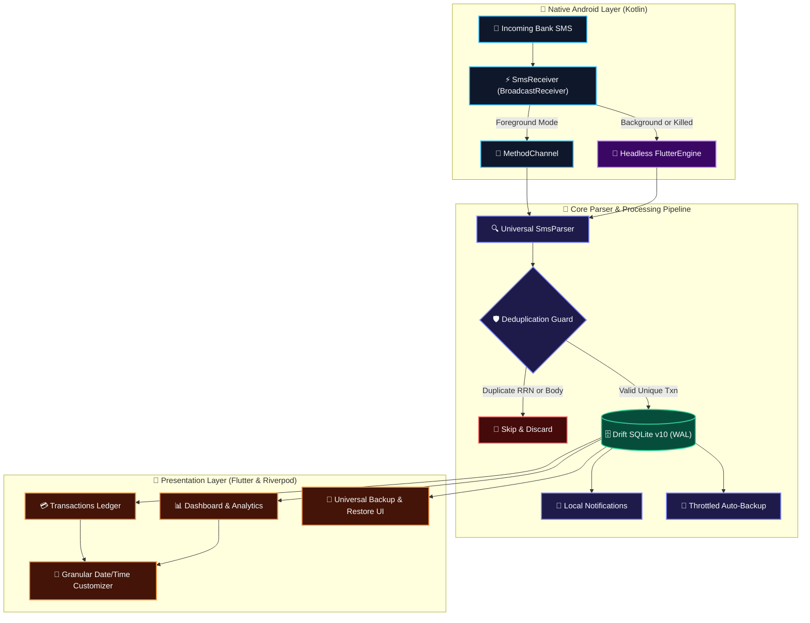

<!-- ═══════════════════════════════════════════════════════════════════ -->
<!-- MONTRA LOGO & ANIMATED WAVING HEADER BANNER                         -->
<!-- ═══════════════════════════════════════════════════════════════════ -->
<p align="center">
  <a href="https://github.com/Yashwant-Rangrej/Montra">
    
  </a>
</p>

<p align="center">
  
</p>

<!-- ═══════════════════════════════════════════════════════════════════ -->
<!-- ANIMATED TYPING SVG BANNER                                          -->
<!-- ═══════════════════════════════════════════════════════════════════ -->
<p align="center">
  <a href="https://github.com/Yashwant-Rangrej/Montra">
    
  </a>
</p>

<!-- ═══════════════════════════════════════════════════════════════════ -->
<!-- VIBRANT STATUS & TECH BADGES                                        -->
<!-- ═══════════════════════════════════════════════════════════════════ -->
<p align="center">
  <a href="https://flutter.dev"></a>
  <a href="https://dart.dev"></a>
  <a href="https://riverpod.dev"></a>
  <a href="https://drift.simonbinder.eu/"></a>
  <a href="https://developer.android.com"></a>
  <a href="#testing"></a>
  <a href="LICENSE"></a>
</p>

<!-- ═══════════════════════════════════════════════════════════════════ -->
<!-- COLORFUL TECH STACK ICONS                                           -->
<!-- ═══════════════════════════════════════════════════════════════════ -->
<p align="center">
  
</p>

<!-- ═══════════════════════════════════════════════════════════════════ -->
<!-- ANIMATED GRADIENT RAINBOW DIVIDER                                   -->
<!-- ═══════════════════════════════════════════════════════════════════ -->
<p align="center">
  
</p>

<!-- ═══════════════════════════════════════════════════════════════════ -->
<!-- INTERACTIVE QUICK NAVIGATION BAR                                    -->
<!-- ═══════════════════════════════════════════════════════════════════ -->
<p align="center">
  <a href="#overview"></a>
  <a href="#key-features"></a>
  <a href="#system-architecture"></a>
  <a href="#database-architecture"></a>
  <a href="#supported-banks"></a>
  <a href="#getting-started"></a>
  <a href="#testing"></a>
  <a href="#privacy"></a>
</p>

---

<a id="overview"></a>
## 📖 Overview

> [!NOTE]
> **Montra** is a personal finance and budget management application engineered to deliver complete financial clarity without ever compromising your privacy. Unlike commercial trackers that harvest and sell personal transaction feeds to ad networks, Montra operates **100% offline and on-device**.

It pairs **autonomous native Android background SMS transaction detection** with a **universal backup & restore engine**, a high-performance **Drift SQLite v10 database**, and **granular past/future date customization**.

---

<a id="key-features"></a>
## 🚀 Key Features

| Feature Subsystem | Core Capabilities & Highlights | Architecture & Engine |
| :--- | :--- | :--- |
|  | • **Universal Regex Heuristics**: Parses IndusInd, HDFC, SBI, Axis, ICICI, Canara, and all Indian bank formats.<br/>• **Smart Attribute Extraction**: Extracts amount, recipient VPA (`user@upi`), payment mode (UPI, Card, Cash), available balance, and bank reference numbers (RRN / UPI Ref).<br/>• **Headless Kotlin Engine**: Android `BroadcastReceiver` catches transactions even when Montra is backgrounded or terminated.<br/>• **Deduplication Guard**: Skips repeated or carrier-retried SMS automatically. | Android Native `BroadcastReceiver` + Headless `FlutterEngine` |
|  | • **Upload Any Format**: Tap Restore and pick backup files in any format (`.json`, `.csv`, etc.) seamlessly.<br/>• **Full Relational JSON**: Exports all 11 tables (Accounts, Categories, Transactions, Budgets, etc.) with schema headers.<br/>• **Excel & Sheets CSV Interoperability**: Human-readable CSV export with auto-headers for spreadsheet tracking.<br/>• **Smart Throttled Auto-Backup**: Periodic background backups with 60-second throttling upon transaction changes. | Streamed JSON/CSV Engine + `file_picker` + `share_plus` |
|  | • **Add & Edit Timestamps**: Pick exact past or upcoming timestamps during creation or anytime after.<br/>• **Native Material 3 Pickers**: Clean date and time dialogs formatted as `EEE, dd MMM yyyy • hh:mm a`.<br/>• **1-Tap "Reset to Now"**: Instantly re-align timestamps back to the current device clock.<br/>• **Dashboard Quick-Edit**: Tap recent ledger entries or use long-press menus to update details in seconds. | Flutter Riverpod Controller + Drift SQLite Reactive Streams |
|  | • **Category & Global Limits**: Set precise monthly expense caps per category or globally.<br/>• **Milestone Alerts**: Real-time interactive alerts trigger at **50%**, **80%**, and **100%+** limit thresholds.<br/>• **Impulse Expense Safeguard**: Configurable single-transaction threshold warnings to curb impulsive purchases.<br/>• **Automated Rollups**: Periodic background calculations compute active expenditure totals. | Android `WorkManager` + Local Notification Service |
|  | • **Zero Cloud Telemetry**: Zero transaction amounts, account numbers, or SMS bodies sent off-device.<br/>• **100% On-Device Processing**: Regex parsing, category mapping, and SQLite storage run strictly locally.<br/>• **Complete Data Sovereignty**: One-tap local data purge or total backup export at any time. | Sandboxed App Storage + SQLite WAL Mode |

<p align="center">
  
</p>

---

<a id="system-architecture"></a>
## 🏗️ System Architecture

Montra implements **Clean Architecture** with a decoupled native pipeline and unidirectional Riverpod state updates:



---

<a id="database-architecture"></a>
## 🗄️ Database Architecture

Montra runs on an optimized **Drift SQLite (Schema v10)** architecture configured with Write-Ahead Logging (`PRAGMA journal_mode=WAL;`) and enforced foreign keys for ACID reliability.

### ⚡ Active B-Tree Performance Indices

| Index Identifier | Target Table | Indexed Column(s) | Performance Optimization |
| :--- | :--- | :--- | :--- |
| `idx_transactions_date` | `transactions` | `transaction_date DESC` | ⚡ Sub-millisecond chronological queries and monthly financial slicing |
| `idx_transactions_category` | `transactions` | `category_id` | ⚡ Accelerates category aggregation and real-time budget limit sums |
| `idx_transactions_account` | `transactions` | `account_id` | ⚡ Fast multi-account filtering across ledgers |
| `idx_transactions_type` | `transactions` | `type` | ⚡ Instant Expense, Income, Transfer, or Ignored transaction queries |
| `idx_transactions_bank_tx_id` | `transactions` | `bank_transaction_id` | ⚡ Instant deduplication check on incoming carrier bank SMS |
| `idx_budgets_month_year` | `budgets` | `month, year` | ⚡ Accelerated active monthly budget and milestone calculations |
| `idx_unrecognized_sms_date` | `unrecognized_sms` | `received_at DESC` | ⚡ Instant retrieval of unparsed SMS audit trails for user review |
| `idx_notifications_date` | `notifications` | `notification_date DESC` | ⚡ Chronological notification center query optimization |

### ⚙️ Smart Database Triggers
* `trg_transactions_default_payment_method`: Automatically assigns `UPI` to incoming SMS transactions (or `Cash` for ATM withdrawals) and defaults manual transactions to `Cash` when left unspecified.

<p align="center">
  
</p>

---

<a id="supported-banks"></a>
## 🏦 Supported Banks & SMS Parser Showcase

<details open>
<summary><b>👉 Click to expand / collapse Supported Bank Formats & Extraction Specs</b></summary>
<br/>

| Bank / Institution | Sample SMS Format | Extracted Fields & Type | Status |
| :--- | :--- | :--- | :---: |
| **IndusInd Bank** | `A/C *XX1234 debited by Rs 1,450.00 towards merchant-pay@upi. RRN:8392014. Avl Bal: INR 8,420.50.` | **Amount:** ₹1,450.00<br/>**Merchant:** `merchant-pay@upi`<br/>**Type:** UPI<br/>**Balance:** ₹8,420.50<br/>**Ref:** `8392014` |  |
| **HDFC Bank** | `Sent Rs.450.00 From HDFC Bank A/C *5678 to Rohan Sharma on 13-10-26 via UPI Ref 928371928371.` | **Amount:** ₹450.00<br/>**Merchant:** `Rohan Sharma`<br/>**Type:** UPI<br/>**Ref:** `928371928371` |  |
| **State Bank of India (SBI)** | `Dear UPI user A/C 9876 debited by 250.0 on 14Oct26 transfer to Swiggy Ref No 327819287319.` | **Amount:** ₹250.00<br/>**Merchant:** `Swiggy`<br/>**Type:** UPI<br/>**Ref:** `327819287319` |  |
| **Axis Bank** | `Your A/C no. XX3456 is debited for Rs.890.00 on 08-10-26 towards swiggy@icici. UPI Ref: 328472918. Avl Bal: INR 12,340.50.` | **Amount:** ₹890.00<br/>**Merchant:** `swiggy@icici`<br/>**Type:** UPI<br/>**Balance:** ₹12,340.50<br/>**Ref:** `328472918` |  |
| **ICICI Bank** | `Acct XX123 debited with INR 500.00 on 09-Oct-26. Info: BIL*123456*Netflix. Available Balance is INR 23,450.00.` | **Amount:** ₹500.00<br/>**Merchant:** `Netflix`<br/>**Category:** Entertainment<br/>**Balance:** ₹23,450.00 |  |
| **ATM Cash Withdrawal** | `Rs 2,000.00 withdrawn from ATM using Debit Card XX1234 on 10-Oct-26. Avl Bal: Rs 15,000.00.` | **Amount:** ₹2,000.00<br/>**Merchant:** `ATM Cash`<br/>**Type:** Cash<br/>**Balance:** ₹15,000.00 |  |

</details>

---

<a id="getting-started"></a>
## 🚦 Getting Started

### Prerequisites
* [Flutter SDK](https://docs.flutter.dev/get-started/install) (`>=3.24.0`)
* Android Studio / VS Code with Dart & Flutter extensions
* Android device or emulator with API Level 26+ (Android 8.0+)

### Setup Instructions

1. **Clone the repository:**
   ```bash
   git clone https://github.com/Yashwant-Rangrej/Montra.git
   cd Montra/montra
   ```

2. **Install Flutter packages:**
   ```bash
   flutter pub get
   ```

3. **Generate Drift SQLite code (if modifying tables):**
   ```bash
   dart run build_runner build --delete-conflicting-outputs
   ```

4. **Run the app:**
   ```bash
   flutter run
   ```

---

<a id="testing"></a>
## 🧪 Testing & Quality Assurance

Montra maintains an automated test suite covering multi-bank SMS parsing, database triggers, deduplication, date customizations, and performance indices.

```bash
# Run all unit, service, and repository tests
flutter test

# Run static code analysis
flutter analyze
```

> [!TIP]
> Current test suite status: **22/22 tests passing** with **0 issues found** on `flutter analyze`.

---

<a id="privacy"></a>
## 🔒 Privacy & Security

> [!IMPORTANT]
> **Your financial data belongs exclusively to you.**
> * **Zero Cloud Telemetry**: Montra transmits zero transaction amounts, account numbers, or SMS contents to external servers.
> * **100% Offline Processing**: All parsing, category mapping, and SQLite storage take place on your local device.
> * **Full Export Control**: You can backup, export to CSV/JSON, or wipe all records at any time from Settings.

---

<!-- ═══════════════════════════════════════════════════════════════════ -->
<!-- ANIMATED WAVING FOOTER BANNER                                       -->
<!-- ═══════════════════════════════════════════════════════════════════ -->
<p align="center">
  
</p>

<a id="license"></a>
<p align="center">
  <sub>Built with ❤️ using Flutter & Drift • Licensed under <a href="LICENSE">MIT</a></sub>
</p>
